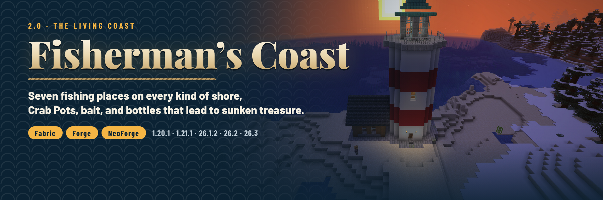

# Fisherman's Coast



A coastal mod for Minecraft (formerly **The Fisherman House**): seven fishing places that sit right on every kind of
shore, named fishermen with their own trades, **Crab Pots** that fish while you are away, three baits, **Fishing Nets**,
and **Messages in a Bottle** that lead to sunken trawlers full of treasure.

**2.0 "The Living Coast"** rebuilds the mod: see the [2.0.0 notes](patchnotes/2.0.0.md), the
[design notes](docs/DESIGN-2.0.md) and the [QA record](docs/QA-2.0.0.md) (in-game checks on all ten builds).

## Which jar do I download?

Jar names are `fisherman_house-{loader}-{minecraft}-{modVersion}.jar`. Match **both** the Minecraft version and the
loader.

| Minecraft | Java | Fabric jar (needs Fabric API) | NeoForge / Forge jar |
|-----------|------|-------------------------------|----------------------|
| 1.20.1 | 17+ | `…-fabric-1.20.1-2.0.0.jar` | `…-forge-1.20.1-2.0.0.jar` (Forge 47.4.0 or newer) |
| 1.21.1 | 21+ | `…-fabric-1.21.1-2.0.0.jar` | `…-neoforge-1.21.1-2.0.0.jar` (NeoForge 21.1.219 or newer) |
| 26.1.2 | 25+ | `…-fabric-26.1.2-2.0.0.jar` | `…-neoforge-26.1.2-2.0.0.jar` (NeoForge 26.1.2.7-beta or newer) |
| 26.2 | 25+ | `…-fabric-26.2-2.0.0.jar` | `…-neoforge-26.2-2.0.0.jar` (NeoForge 26.2.0.93 or newer) |
| 26.3 | 25+ | `…-fabric-26.3-2.0.0.jar` | `…-neoforge-26.3-2.0.0.jar` (NeoForge 26.3.0.97 or newer) |

Install it on the server and on clients. No other library is needed. On 1.21.1 there is no Forge build any more
(Fabric or NeoForge); see the patch notes.

## Features

### Seven places on the coast

| Structure | Where | Resident | What is there |
|-----------|-------|----------|---------------|
| Fisherman's Cottage | sandy and snowy beaches | Saylor | the original stilt house over the shallows with its boardwalk, repaired |
| Harbour Pier | sandy beaches | Harbourmaster Wren | a bait shop and a long pier with a T-head, lamp posts, net racks, a crane and a bell |
| Lighthouse | stony shores and beaches | Keeper Morrow | a red and white tower with a lit lantern room under a copper cap, and the keeper's cottage |
| Stilt Shack | swamps and mangrove swamps | Old Bayou Tam | a mangrove hut on stilts with a porch and a little dock |
| Ice Fishing Camp | frozen oceans and rivers | Frost-Beard Ole | a hut on an ice shelf over a hole with a pot already set, a tent, a campfire and a sled |
| River Boathouse | the banks of rivers and lakes | Ferryman Hale | a cottage and a roofed slip with a boat in it |
| Sunken Trawler | the floor of the oceans | two drowned deckhands | a broken fishing boat: the hold's barrels and the captain's chest |

**Shore-aware placement:** before a structure is placed, the land is sampled. Docks and piers are turned to point into
water at least three blocks deep, land parts need dry and level ground, the ice camp sits on open water (which then
freezes around it), the stilt shack on swamp water or swamp land and the wreck on the sea floor under at least twelve
blocks of water. A spot that does not fit is skipped.

Every container draws from its structure's loot table, and every resident is a journeyman fisherman with exclusive
trades: bait, Crab Pots, Fishing Nets, Messages in a Bottle and more; once those are used, the resident levels up like
any fisherman.

### Crab Pot

Set it in water with open water around it (20 water blocks in the 5×3×5 box around it): every 60 to 120 seconds it
catches something and stores it in its 5 slots. The catch depends on where it is (frozen water, swamps, rivers, the sea
and beaches, anywhere else), with vanilla's fish so fish from other mods are caught too. It works twice as fast in the
rain. When it is full it waits instead of losing anything.

* **Bait**: put bait in by hand (right-click) or with a hopper. Fish Bait halves the wait, Chum cuts it to about a
  third and adds luck, Glow Bait adds a lot of luck (more treasure, more bottles). One bait per catch.
* **Automation**: hoppers and pipes can put bait in from any side and take the catch out (never the bait).
  Comparators read how full it is.
* Right-click to open it; sneak-right-click with an empty hand for its status (water, bait, time to the next catch).
* The model shows the bait inside and the catch once there is one; a baited pot leaks bubbles, a catch splashes.

### Bait

| Item | Recipe (shapeless) | In a Crab Pot |
|------|--------------------|---------------|
| Fish Bait ×4 | wheat seeds + rotten flesh | waits ×0.5 |
| Chum ×4 | cod or salmon + rotten flesh + bone meal | waits ×0.35, luck +1 |
| Glow Bait ×4 | glow berries + glow ink sac | luck +3 |

### Message in a Bottle

Fished up by rods (1.5 % of catches, on top of the normal catch), caught by Crab Pots (more often with Glow Bait),
found in the structures and sold by residents. Right-click to break it open: a note from the sea is read out, and the
bottle holds either a small treasure or a **map to the nearest Sunken Trawler**, whose captain's chest is the best loot
on the coast.

### Fishing Net

A see-through net that hangs on a wall like a ladder, can be climbed and can be waterlogged. Recipe: five string in
an X makes four.

### Advancements

A "Fisherman's Coast" tab: find each of the seven places, get a Crab Pot, buy one from a resident, open a Message in
a Bottle, and visit all seven (Coastal Wanderer).

## Configuration

`config/fisherman_house.json` is written on first start, with comments. Changes apply after a restart.

| Key | Default | What it does |
|-----|---------|--------------|
| `crab_pot.min_seconds`, `crab_pot.max_seconds` | `60`, `120` | Time between catches without bait (random in between) |
| `crab_pot.min_water` | `20` | Water blocks needed in the 5×3×5 box around a pot (74 at most) |
| `crab_pot.rain_bonus` | `true` | Pots work twice as fast while it rains on them |
| `structures.<id>` | `true` | Set to `false` to stop a structure generating in new chunks |

## Datapacks

Everything else is data and can be changed by a datapack:

| What | Where (`data/fisherman_house/…`) |
|------|----------------------------------|
| Biomes of a structure | `tags/worldgen/biome/has_structure/<id>.json` |
| Spacing, separation, distance from villages | `worldgen/structure_set/<id>.json` |
| Shore rules, template and sample points | `worldgen/structure/<id>.json` (type `fisherman_house:coastal`) |
| Structure loot | `loot_table/chests/<id>.json` (`loot_tables/` on 1.20.1) |
| Crab Pot catches | `loot_table/gameplay/crab_pot/{frozen,swamp,river,ocean,default}.json`, chosen by the biome tags `tags/worldgen/biome/crab_pot/*` in that order |
| What a bottle holds | `loot_table/gameplay/message_in_a_bottle.json` |
| Where bottle maps lead | `tags/worldgen/structure/on_bottle_maps.json` |

`/locate structure fisherman_house:<id>` finds one structure, `/locate structure #fisherman_house:coastal` any of them.
Operators can run `/fishermanscoast inspect [pos] [fill]` (or `inspect area <from> <to> [fill]`) to list what a
structure holds: its loot tables, residents and their trades, Crab Pots and nets.

## Upgrading from 1.x

The mod id is still `fisherman_house` and the house keeps its structure id, so worlds from 1.x load as they are:
houses already generated stay, and one that 1.x left half-generated at the edge of the explored world is finished from
its original 1.x template (still in the mod). New chunks get the new structures and the new placement. On 1.21.1, switch
from the Forge jar to the NeoForge (or Fabric) jar.

## Building

Each Minecraft version is a separate MultiLoader Gradle workspace (`common/`, `fabric/` and `neoforge/`, or `forge/`
on 1.20.1). Gradle needs the workspace's Java version: 17 for 1.20.1, 21 for 1.21.1, 25 for 26.x.

```bash
cd 26.3
./gradlew build          # jars in fabric/build/libs and neoforge/build/libs; runs the unit tests
```

`tools/build_release.sh` builds every workspace and copies the jars into `releases/` for the publish workflow.
Release notes for a version live in `patchnotes/<version>.md`.

## Tools

- [`tools/structures.py`](tools/structures.py) and [`tools/nbtbuild.py`](tools/nbtbuild.py): build the structure
  templates (and repair the 1.x house) and record where each one samples the shore.
- [`tools/datagen.py`](tools/datagen.py): writes assets and data (models, loot tables, recipes, advancements, tags,
  structures, loot modifiers) into every workspace in that version's format. Edit the tables there, not the JSON.
- [`tools/gen_textures.py`](tools/gen_textures.py): draws the block and item textures.
- [`tools/qa/`](tools/qa): dev servers and a real game client under Xvfb. `coast_checks.py` checks every feature in
  game, `run_matrix.sh` runs it on every build, `prodserver.sh` tests a release jar on a real server, `migration.sh`
  opens a 1.1.0 world with 2.0, `rarity.py` measures how far apart the structures are,
  `marketing_shots.py` captures the listing screenshots.
- [`marketing/`](marketing): the CurseForge/Modrinth description, listing images and how to regenerate them.

## Links

- [Discord](https://discord.gg/SAmd9fhNhr)
- [Source and issues](https://github.com/MeherBenSalem/the-fisherman-house)
- [Support us](https://nightbeam.dev/support)

## Contributing

See [CONTRIBUTING.md](CONTRIBUTING.md). Please follow the [Code of Conduct](CODE_OF_CONDUCT.md).

## Security

See [.github/SECURITY.md](.github/SECURITY.md).

## License

[Apache License 2.0](LICENSE). See [NOTICE](NOTICE).
